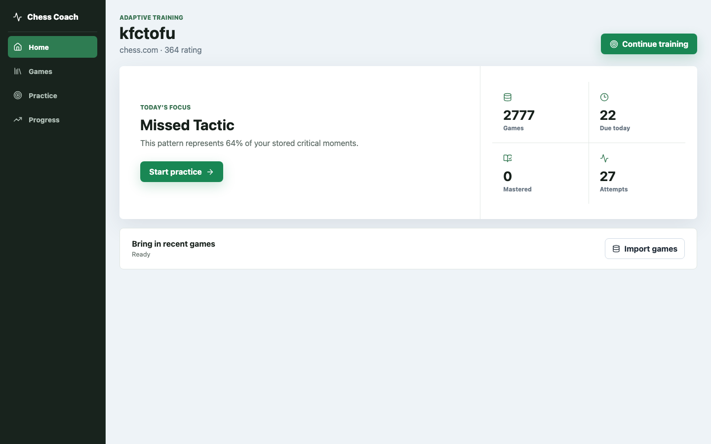
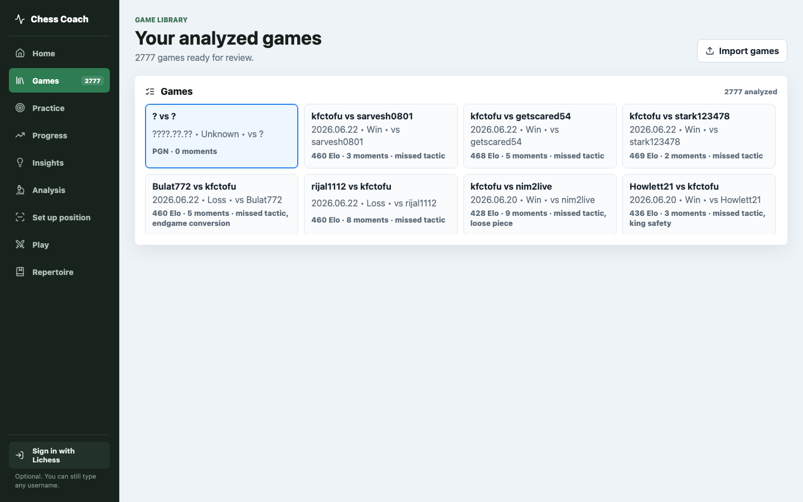
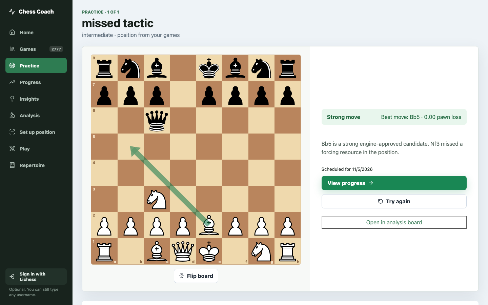

# Chess Coach Agent

[](https://render.com/deploy?repo=https://github.com/leo-cabibihan/chess-coach-agent)

**Live app:** <https://chess-coach-agent.onrender.com/>

Chess Coach Agent is my capstone for the AI Engineering Buildcamp. It imports a player's Chess.com,
Lichess, or PGN games, finds the moves that cost the most, and turns them into practice. A
PydanticAI agent with nine chess tools answers questions about the game on screen, using
Stockfish evaluations and the player's stored games as its source of facts.

```text
Import games -> Detect weaknesses -> Practice -> Evaluate -> Adapt
                        \-> Ask the coach about any game or position
```

## Demo

[`docs/chess-coach-demo.mp4`](docs/chess-coach-demo.mp4) (2 min 40 s) walks through the game
library, a game review with critical moments and the heatmap, two questions to the coach, a
Stockfish-graded drill with a coach hint, the progress page and the `/quality` dashboard.

| Dashboard | Game library | Practice |
| --- | --- | --- |
|  |  |  |

## Problem

Club players collect hundreds of online games and rarely turn them into a training plan. An engine
can say a move lost 2.3 pawns, but it does not say which human habit caused it: a loose piece, a
missed check, an uncastled king, a queen that wandered around in the opening. Players also forget
the lesson, because nothing brings the same position back a week later.

This project addresses three gaps:

1. **Finding the moments that matter.** Stockfish scores every move. Critical moments are picked
   with Lichess-style winning-chance thresholds, so a game can have zero or ten of them.
2. **Explaining them in plain language.** Theme detectors label the human pattern, curated lessons
   supply the principle, and the AI coach answers follow-up questions about the game or the
   current board.
3. **Making the lesson stick.** Mistakes become board drills graded by Stockfish. Failed positions
   come back after 1 day, hinted ones after 3, clean ones after 7, with intervals doubling up to 30
   days. Difficulty adapts per theme.

## Features

What sets this apart from Chess.com Game Review, Lichess analysis and Aimchess is that every
screen is built from the player's own games: the coach answers from stored Stockfish evaluations
of those games, practice drills are the player's own mistakes, and the sparring bot plays the
openings their real opponents played.

Review and coaching:

- Full-history sync from Chess.com or Lichess (up to 5,000 games) as a background job; games
  already analyzed are skipped. Pasting PGN also works.
- Move labels (brilliant, great, best, excellent, good, book, inaccuracy, mistake, miss, blunder)
  and per-side accuracy, both on Lichess win-chance formulas
  ([`docs/moment_selection.md`](docs/moment_selection.md)). Clock times from `%clk` comments mark
  moves played in time pressure.
- Game review with an eval bar, eval graph, labeled move list, retry-the-mistake drills and
  annotated PGN download.
- Theme detection: loose piece, opening drift, king safety, endgame conversion, missed tactic,
  time pressure.
- **AI coach panel** on the review, practice and analysis pages (see
  [AI coach](#ai-coach-agent-and-tools)). It draws arrows and highlights on the board (checked
  for legality with python-chess), can read its answer aloud, and takes helpful / not-helpful
  feedback.
- Square-control heatmap with You / Opponent / Both / Off modes.
- **Practice agent:** with `OPENROUTER_API_KEY` set, starting a practice session runs a PydanticAI
  agent that ranks the player's stored mistakes and writes the quiz prompt and hint for each
  position. Without a key it falls back to deterministic ranking and template copy.

Training:

- A puzzle page: 5,000 Lichess puzzles to browse by theme and rating and solve on the board.
- Insights by time of day and weekday, with sample sizes and likely ranges shown.
- Practice sessions built from the player's own mistakes, mixed with rated Lichess puzzles on the
  same themes, graded with Stockfish and scheduled with spaced repetition.
- Time trainer: a timed practice mode built from the player's clock data. It serves positions
  where they rushed a critical move or spent too long on a simple one, then compares both clock
  times and Stockfish's verdict.
- Opening repertoire builder with a spaced-repetition drill for each line.
- Endgame trainer: play out essential positions and endgames you let slip against Stockfish.
- Eight bots from 600 to 2200 with different styles. They pick moves from Stockfish's candidate
  list with rating-based noise and occasional blunders, so they lose like people do. A sparring
  partner replays the moves your past opponents chose in each opening.

Analysis tools:

- Analysis board with variations, Stockfish lines and the Lichess opening explorer.
- Board from an image: upload, paste or drop a screenshot and a vision model reads the position
  into an editor.
- Insights: where points are lost, by theme, phase, color and opening.
- Progress charts for rating, results, theme accuracy and mastery.
- Optional sign in with Lichess (OAuth PKCE), and a `/quality` monitoring dashboard.

## AI coach (agent and tools)

The coach is a PydanticAI `Agent` defined in `backend/src/chess_coach_agent/llm.py`. It runs on
Claude Haiku 5.5 through OpenRouter (`OPENROUTER_MODEL`, default `anthropic/claude-haiku-5.5`).

### Request flow

```text
CoachPanel (React)                         FastAPI                           PydanticAI agent
------------------                         -------                           ----------------
question, player, game id,   POST /api/coach/ask   load selected game's
board FEN, message history  ------------------->  critical moments + player   -> prompt with verified
                                                   weakness memory               context
                                                                                 -> calls 0..n tools
                            <-------------------  CoachAskResponse          <- CoachingOutput (validated)
render answer, evidence,                          (answer, tools_used,
drill, tools used                                  message_history, used_llm)
```

- The server is stateless. The browser holds the PydanticAI message history and sends it back with
  each question, so follow-ups keep context.
- Before the model runs, the server adds verified context: the selected game's critical moments
  (move, played move, engine move, theme, FEN), the FEN on the player's board, and the player's
  recurring weakness themes, quiz accuracy, and due-position counts.
- Output is a validated `CoachingOutput` Pydantic model: `answer`, `evidence`, `recommended_move`,
  `principle`, `drill`, `confidence` (0 to 1).
- If `OPENROUTER_API_KEY` is missing, or the run fails or exceeds `COACH_TIMEOUT_SECONDS` (default
  60), the endpoint returns a deterministic answer built from the game's top engine-verified moment
  and the best-matching lesson, with `used_llm: false`. The UI labels it "Offline answer from engine
  analysis".
- Every answer logs a `coach_answered` event (player, game id, whether the LLM was used, tools
  called). With `LOGFIRE_TOKEN` set, each run is traced in Logfire, including tool calls.

### Tools

The agent decides which tools to call. The instructions tell it to skip tools when the verified
context already answers the question.

| Tool | Defined in | Input | What it returns |
| --- | --- | --- | --- |
| `search_chess_principles` | `llm.py` | `query` | Top 3 lesson snippets from the knowledge base, with retrieval scores |
| `inspect_critical_moments` | `llm.py` | none (uses selected game) | Up to 4 critical moments: move number, phase, theme, played move, engine move, eval swing, principle |
| `inspect_position` | `llm.py` | `fen` | Stockfish best move and evaluation for a FEN, plus available checks and captures |
| `build_training_drill` | `llm.py` | `theme` (optional) | A drill for the selected game's main weakness |
| `inspect_game` | `coach_tools.py` | `game_id` | A stored game's players, result, rating, and all critical moments ordered by severity |
| `compare_moves` | `coach_tools.py` | `fen`, `candidate_moves` (up to 6) | Legality and Stockfish evaluation for each candidate, best first |
| `generate_position_quiz` | `coach_tools.py` | `theme`, `difficulty` | A quiz built from the player's own stored critical moments |
| `evaluate_candidate_move` | `coach_tools.py` | `position_id`, `move` | Stockfish grading of a move in a saved training position (records the attempt) |
| `build_training_session` | `coach_tools.py` | none | The next adaptive quiz from the player's weakness and quiz history, plus the player profile |

Stockfish, `python-chess` legality checks, and stored game data are the source of truth for chess
facts. The model writes the explanation; it is told never to invent variations.
[`docs/pydantic_ai_map.md`](docs/pydantic_ai_map.md) walks through the agent code.

## Knowledge base and retrieval

The knowledge base is four hand-written lessons in `backend/data/knowledge/` (tactical vision,
loose pieces, opening principles, king safety). `ingest_knowledge` splits them into chunks and
stores them with 384-dimensional vectors in the database (a pgvector column on Postgres). Search
itself runs over the lesson files: BM25 is pure Python, and vector search uses FastEmbed
`bge-small-en-v1.5` when `ENABLE_LOCAL_EMBEDDINGS=true` and a hashed bag-of-words vector
otherwise.

Four retrieval strategies were benchmarked on 20 hand-written queries
(`backend/data/eval/retrieval.jsonl`):

| Strategy | Hit rate at 3 | MRR | Source correctness | Median latency |
| --- | ---: | ---: | ---: | ---: |
| Title-only | 0.35 | 0.35 | 0.65 | 0.08 ms |
| BM25 | 0.95 | 0.858 | 0.95 | 0.12 ms |
| Vector | 0.95 | 0.725 | 0.95 | 0.33 ms |
| Hybrid RRF | 1.00 | 0.850 | 1.00 | 0.63 ms |

Production uses BM25. Hybrid would only replace it if it matched BM25 on hit rate and MRR while
staying under twice its latency; it lost on MRR and latency. The choice is read from
`backend/data/eval/retrieval_results.json` at runtime (override with `RETRIEVAL_STRATEGY`). BM25
feeds the coach's `search_chess_principles` tool, the offline fallback answer, and the lesson notes
attached to each analysis. Details: [`docs/evaluation_results.md`](docs/evaluation_results.md).

## Project structure

```text
chess-coach-agent/
├── backend/                         Python package (uv, FastAPI, PydanticAI)
│   ├── src/chess_coach_agent/
│   │   ├── api.py                   FastAPI app: health, analyze, feedback, monitoring, static UI
│   │   ├── adaptive_api.py          Sync, players, training, progress, coach routes
│   │   ├── llm.py                   PydanticAI coach agent, 4 tools, fallback, OpenRouter client
│   │   ├── coach_tools.py           5 database and Stockfish tools for the agent
│   │   ├── agent.py, analysis.py    PGN import and critical-moment detection
│   │   ├── engine.py                Stockfish wrapper with heuristic fallback
│   │   ├── pgn.py, importers.py     PGN parsing, Chess.com and Lichess clients
│   │   ├── training.py              Practice sessions, move grading, spaced repetition
│   │   ├── knowledge.py             BM25, vector, hybrid retrieval
│   │   ├── embeddings.py            FastEmbed vectors
│   │   ├── ingest_knowledge.py      Chunk and store lessons
│   │   ├── db.py, db_models.py,     SQLAlchemy models and repositories
│   │   │   repositories.py
│   │   ├── models.py                Pydantic API and agent output schemas
│   │   ├── monitoring.py            JSONL event log, dashboard summary, feedback export
│   │   ├── evaluation.py            Theme-detection evaluation
│   │   ├── retrieval_evaluation.py  Retrieval benchmark
│   │   └── judge_evaluation.py      LLM-as-judge evaluation and prompt comparison
│   ├── tests/                       pytest suite
│   ├── data/
│   │   ├── knowledge/               Lesson markdown (knowledge base)
│   │   ├── eval/                    Ground truth and retrieval datasets, benchmark results
│   │   └── sample_games/            Sample PGN for reviewers
│   └── migrations/                  Alembic migrations
├── frontend/                        React + Vite + TanStack Router/Query
│   └── src/
│       ├── components/              CoachPanel, GamePanel (board + heatmap), AnalysisPanel, MonitoringDashboard
│       ├── pages/                   Home, Practice, Progress
│       ├── lib/                     API client, types, squareControl (heatmap math)
│       └── router.tsx               Routes, game review, quality page
├── docs/                            Design, evaluation, monitoring docs
├── scripts/score_project.py         Course rubric self-scorer
├── Dockerfile                       Single image: React build + FastAPI + Stockfish (Render)
├── Dockerfile.backend, Dockerfile.frontend, docker-compose.yml
├── Makefile, render.yaml, .github/workflows/ci.yml, .env.example
```

## Setup and running

### Prerequisites

- Python 3.11+ and [uv](https://docs.astral.sh/uv/)
- Node.js 22
- Stockfish (optional; `brew install stockfish` or `apt install stockfish`). Without it, analysis
  falls back to legal-move and material heuristics.
- An OpenRouter API key (optional; without it the coach returns the offline engine-based answer)

### Environment variables

Copy `.env.example` to `.env` at the repo root. Every variable is optional.

| Variable | Default | Purpose |
| --- | --- | --- |
| `OPENROUTER_API_KEY` | empty | Enables the live coach and the LLM judge |
| `OPENROUTER_MODEL` | `anthropic/claude-haiku-5.5` | Model for the coach, practice agent and judge |
| `CHESSCOM_API_CONTACT`, `LICHESS_API_CONTACT` | placeholder | Contact sent in the User-Agent; Chess.com may answer 403 without one |
| `VISION_MODEL` | `google/gemini-3.8-flash` | Reads boards from images. It read 6 of 6 test boards; Haiku read 3 of 6 |
| `COACH_TIMEOUT_SECONDS` | `60` | Coach run timeout before the fallback answer |
| `LOGFIRE_TOKEN` | empty | Sends PydanticAI traces to Logfire |
| `DATABASE_URL` | SQLite at `backend/data/chess_coach.db` | Postgres URL in Docker and Render |
| `STOCKFISH_PATH` | auto-detect | Path to the Stockfish binary |
| `STOCKFISH_DEPTH` | `9` | Engine search depth |
| `STOCKFISH_MAX_NODES` | `60000` | Node cap per analyzed position |
| `LICHESS_API_TOKEN` | empty | Needed for the opening explorer; Lichess now rejects anonymous explorer requests. Create one at <https://lichess.org/account/oauth/token> with no scopes |
| `SESSION_SECRET` | empty | Signs the session cookie and Chess.com link codes; set a long random value in production |
| `LICHESS_CLIENT_ID` | `chess-coach-agent` | Name shown on the Lichess consent screen |
| `PUBLIC_BASE_URL` | derived from the request | Origin used for the OAuth redirect URI |
| `COACH_DAILY_LIMIT_ANONYMOUS`, `COACH_DAILY_LIMIT_FREE`, `COACH_DAILY_LIMIT_PAID` | `5`, `20`, `200` | Coach questions per UTC day. Anonymous visitors are counted per address |
| `TRUSTED_PROXY_HOPS` | `0` | How many proxies in front of the app append to `X-Forwarded-For`. Set it behind a proxy, or all anonymous visitors share one limit |
| `MONITORING_LOG_PATH` | `backend/data/logs/events.jsonl` | JSONL event log |
| `ENABLE_LOCAL_EMBEDDINGS` | `false` | Compute FastEmbed vectors for vector/hybrid retrieval |
| `RETRIEVAL_STRATEGY` | from benchmark (`bm25`) | Force `bm25` or `hybrid` |

### Quickstart (local)

```bash
cp .env.example .env            # add OPENROUTER_API_KEY to enable the live coach

# backend
cd backend
uv sync --extra dev
uv run alembic upgrade head
uv run python -m chess_coach_agent.ingest_knowledge
uv run uvicorn chess_coach_agent.api:app --reload --host 127.0.0.1 --port 8000

# frontend (second terminal)
cd frontend
npm install
npm run dev
```

Open <http://127.0.0.1:5173>. On the Games page, click Import games and either sync a Chess.com
or Lichess username or analyze the PGN box, which is prefilled with the sample game from
`backend/data/sample_games/kfctofu_sample.pgn`. Open a game to see
the board, heatmap, critical moments, and the Coach panel.

### Makefile

| Command | What it does |
| --- | --- |
| `make install` | `uv sync` for the backend and `npm install` for the frontend |
| `make migrate` / `make seed` | Run Alembic migrations / ingest the knowledge base |
| `make backend` / `make frontend` | Start the API on :8000 / the Vite dev server on :5173 |
| `make test` | pytest plus a production frontend build |
| `make eval` | Theme-detection evaluation on the ground truth dataset |
| `make retrieval-eval` | Retrieval benchmark, writes `retrieval_results.json` |
| `make eval-llm` | LLM judge with prompt-format comparison (needs `OPENROUTER_API_KEY`) |
| `make feedback-export` | Turn feedback logs into evaluation candidates |
| `make score` | Run the course rubric self-scorer |

### Docker

`docker compose up --build` starts Postgres with pgvector, the FastAPI backend with Stockfish
(it runs migrations and lesson ingestion on start), and the Vite frontend. Compose reads
`OPENROUTER_API_KEY` and `OPENROUTER_MODEL` from `.env`. The API is at <http://localhost:8000>.
Known issue: the frontend container's Vite proxy points `/api` at `127.0.0.1:8000`, which inside
that container is not the backend, so use the single image below to try the full UI in Docker.

The root `Dockerfile` builds one image that serves the built React app and the API together, the
same image Render runs:

```bash
docker build -t chess-coach-agent .
docker run -p 8000:8000 --env-file .env chess-coach-agent   # open http://localhost:8000
```

### Data

All data needed to run and evaluate the project is in the repo: the sample PGN, the four lesson
files, the 11-case ground truth dataset, and the 20-query retrieval dataset. Live game sync uses
the public Chess.com and Lichess APIs and needs no key.

## Testing

```bash
cd backend
uv run pytest -q        # or: make test
```

The suite has 18 tests in 11 modules and needs no network or API key.

| Type | Tests | What they check |
| --- | --- | --- |
| Unit | `test_pgn.py`, `test_importers.py`, `test_analysis.py`, `test_adaptive_training.py`, `test_retrieval.py`, `test_evaluation.py` | PGN parsing, importer IDs, winning-chance thresholds, critical moments, adaptive difficulty, BM25 winning the benchmark |
| Agent | `test_tools.py`, `test_api.py` | With PydanticAI `TestModel`: all nine tools are registered, tools run and fill `tools_used`, output validates as `CoachingOutput`, `/api/coach/ask` returns message history, and the fallback works without a model |
| Integration | `test_adaptive_api.py`, `test_monitoring.py` | Sync deduplication, training and progress flow end to end, feedback reaching the dashboard and the export |
| Judge | `test_judge.py` | The LLM-judge pipeline runs on the ground truth dataset with a fake judge, so the test suite is deterministic, and selects the grounded format |

Tests use a temporary SQLite database (`backend/tests/conftest.py`). CI runs the same suite, both
offline evaluations, Postgres migrations against a pgvector service, and the frontend build.

## Evaluation

| What | How | Docs |
| --- | --- | --- |
| Ground truth dataset | 11 hand-written positions in `backend/data/eval/critical_moments.jsonl`, each with an expected theme and reviewer notes. Not LLM-generated. | [`docs/manual_evaluation.md`](docs/manual_evaluation.md) |
| Theme detection | `make eval`: 11/11 expected themes detected | [`docs/evaluation_results.md`](docs/evaluation_results.md) |
| Retrieval | `make retrieval-eval`: 4 strategies on 20 queries; BM25 selected | [`docs/evaluation_results.md`](docs/evaluation_results.md) |
| LLM judge | `make eval-llm`: the configured OpenRouter model scores coaching output against the reviewer notes on theme, grounding, and coaching quality (0-2 each, 6 max) | [`docs/evaluation_results.md`](docs/evaluation_results.md) |
| Tuning | The judge compared a concise and a grounded answer format, then flagged a weak opening-drift explanation, which was rewritten | [`docs/evaluation_results.md`](docs/evaluation_results.md) |
| Live coach | `make eval-coach`: 15 hand-written player questions with Stockfish-verified answers, run through the real coach agent; deterministic checks plus an LLM judge (8 max) compare prompts and models. Haiku 5.5: 6.2/8, expected move 83-92%, about 8 s per answer | [`docs/evaluation_results.md`](docs/evaluation_results.md) |
| Agent scenarios | `uv run python -m chess_coach_agent.agent_evaluation --dataset data/eval/agent_scenarios.jsonl`: 10 scenarios check the practice agent's tool routing; 10/10 offline (add `--live` for real runs) | [`docs/evaluation_results.md`](docs/evaluation_results.md) |
| Manual evaluation | Two cases reviewed by hand against the ground truth: 2/2 acceptable, one improvement noted | [`docs/manual_evaluation.md`](docs/manual_evaluation.md) |

Judge results:

| Format | Average score | Pass rate |
| --- | ---: | ---: |
| Concise | 3.0/6 | 50% |
| Grounded, before tuning | 5.0/6 | 100% |
| Grounded, after tuning | 5.5/6 | 100% |

After tuning, opening drift went from 4/6 to 6/6. The datasets are small; these scores show the
workflow works, not that the coach is accurate in general. The judge scores the analysis
explanations; answers from the live coach are not yet judged.

## Monitoring and feedback

- **Logs.** Every analysis, sync, practice session, quiz attempt, feedback rating, and coach answer
  is appended to a JSONL file (`MONITORING_LOG_PATH`). With `LOGFIRE_TOKEN` set, PydanticAI runs
  (coach questions and tool calls) are also traced in Logfire.
- **Dashboard.** `/quality` in the app calls `GET /api/monitoring`, which aggregates the JSONL log:
  analyses, feedback count and helpful rate, training sessions, quiz accuracy, hint use, and a bar
  chart of event counts, including `coach_answered`. `uv run python -m chess_coach_agent.monitoring --summary`
  prints the same summary.
- **User feedback.** Each critical moment has helpful / not-helpful buttons that call
  `POST /api/feedback` and show up on the dashboard.
- **Logs to dataset.** `make feedback-export` turns feedback events into rows shaped like the
  ground truth dataset (FEN, expected theme, rating, comment) marked `review_status: candidate`. A
  person reviews them before they join `critical_moments.jsonl`, and then `make eval` and
  `make eval-llm` run on them.

Details: [`docs/monitoring.md`](docs/monitoring.md).

## UI

The React app (TanStack Router and Query) has these pages:

| Route | Page |
| --- | --- |
| `/` | Dashboard: rating, weaknesses, due positions, continue training |
| `/games` | Game library and full-history sync |
| `/games/:gameId?moment=:id` | Game review: board with square-control heatmap, move list, critical moments, feedback buttons, Coach panel |
| `/practice`, `/practice/:sessionId` | Board drills and puzzles graded by Stockfish, with a Coach panel for hints. `/practice?mode=time` opens the time trainer |
| `/progress` | Rating, results, theme accuracy, mastery charts |
| `/insights` | Where points are lost: themes, phases, colors, openings |
| `/analysis?fen=` | Analysis board with engine lines, opening explorer and the coach |
| `/setup` | Board editor and board-from-image reader |
| `/play?fen=` | Play the bots, then review the game with the coach |
| `/repertoire` | Build opening lines and drill them |
| `/endgames` | Play essential endgames and your own thrown endgames against Stockfish; the engine judges the result and schedules the review |
| `/quality` | Monitoring dashboard (not in the sidebar) |

The heatmap counts how many pieces of each side attack each square in the current position
(`frontend/src/lib/squareControl.ts`). You and Opponent shade one side's control; Both colors each
square for whichever side has more attackers. The bar names the strongest square and the piece
with the fewest defenders, which ties the "loose piece" lessons to what is on the board. A flip
button turns the board around. Details: [`docs/ui-integration.md`](docs/ui-integration.md).

## Deployment

The app runs on Render at <https://chess-coach-agent.onrender.com/>. `render.yaml` defines one Docker
web service (root `Dockerfile`: React build, Stockfish, Alembic migrations, lesson ingestion,
FastAPI) and a managed Postgres database, with `/api/health` as the health check.

To deploy your own copy, click the Deploy to Render button, or create a Blueprint from the repo.
Render asks for `OPENROUTER_API_KEY` because it is declared with `sync: false`. The free plan
writes monitoring JSONL to `/tmp`, so the dashboard resets on restart; attach a disk and point
`MONITORING_LOG_PATH` at it to keep events.

## Documentation

| Doc | Contents |
| --- | --- |
| [`docs/architecture.md`](docs/architecture.md) | Learning loop, storage, retrieval, coach flow, API surface |
| [`docs/pydantic_ai_map.md`](docs/pydantic_ai_map.md) | The PydanticAI agent, tools, output model, and tests |
| [`docs/moment_selection.md`](docs/moment_selection.md) | Winning-chance thresholds and theme rules |
| [`docs/evaluation_results.md`](docs/evaluation_results.md) | Retrieval benchmark and LLM judge tuning |
| [`docs/manual_evaluation.md`](docs/manual_evaluation.md) | Hand-reviewed ground truth cases |
| [`docs/monitoring.md`](docs/monitoring.md) | JSONL events, Logfire, feedback, dashboard |
| [`docs/ui-integration.md`](docs/ui-integration.md) | Which API each page calls and what it logs |
| [`docs/chess-coach-presentation.html`](docs/chess-coach-presentation.html) | Single-page codebase guide for presentations |

## Self-evaluation

Scored against the course rubric. `python3 scripts/score_project.py` runs the automated version.

| Criterion | Points | Evidence |
| --- | ---: | --- |
| Problem description | 2/2 | [Problem](#problem) |
| Knowledge base and retrieval | 2/2 | Lesson base, 4 strategies benchmarked on 20 queries, best one selected by code ([Knowledge base](#knowledge-base-and-retrieval)) |
| Agents and LLM | 3/3 | PydanticAI agent with nine documented tools ([Tools](#tools)) |
| Code organization | 2/2 | Python package under `backend/src`, structure documented ([Project structure](#project-structure)) |
| Testing | 2/2 | Unit, agent, integration, and judge tests; how to run is documented ([Testing](#testing)) |
| Evaluation | 3/3 | LLM judge on a ground truth dataset, used to compare prompt formats and tune an explanation |
| Evaluation bonus | 4/4 | Hand-written ground truth (2), manual evaluation (2) |
| Monitoring | 2/2 | JSONL logs, Logfire traces, `/quality` dashboard |
| Monitoring bonus | 3/3 | Feedback buttons (1), feedback export to reviewable dataset rows (2) |
| Reproducibility | 2/2 | Setup, env vars, sample data in repo ([Setup](#setup-and-running)) |
| Best coding practices | 7/7 | Dockerfiles (1), docker-compose (2; the compose frontend proxy needs a fix, so a strict reviewer may give 5/7), Makefile (1), uv (1), GitHub Actions CI (2) |
| Additional bonus | 3/3 | React UI (1), deployed on Render (2) |
| **Total** | **35/35** | |

Known limits: the knowledge base has only four lessons; the ground truth has 11 cases, two of them
manually scored; the LLM judge evaluates analysis explanations, not live coach answers; feedback
buttons exist on critical moments but not on coach answers; the dashboard counts coach answers as
events but does not yet show their tool usage or token cost.
